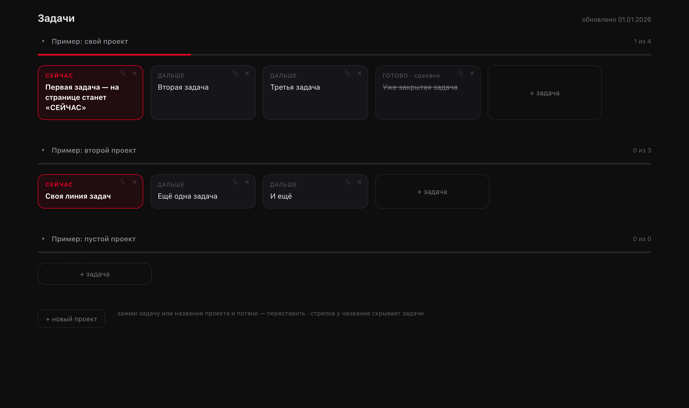

# Линейка задач

Одностраничный «задачник», где задачи каждого проекта выстроены **в линию**, а не свалены
списком. Над головой всегда висит ровно одна задача — первая незакрытая. Закрыл — линия сама
сдвинулась. Открывается как обычная веб-страница, которую можно вывести иконкой на домашний
экран телефона.

Задачи правятся **прямо на странице**, без редакторов и команд: отметить, вернуть, переписать
текст, переставить, добавить, спрятать проект.



---

## Что умеет

- **Проекты отдельными линиями.** У каждого — своё название и очередь задач. Первая незакрытая
  подсвечена как «СЕЙЧАС», следующие — «ДАЛЬШЕ», закрытые гаснут и зачёркиваются.
- **Отметить / вернуть — два тапа.** Первый тап только спрашивает («ТАПНИ ЕЩЁ РАЗ»), второй —
  применяет. Передумал — через 4 секунды подсветка гаснет сама.
- **Переставить — зажать и потянуть.** Держишь задачу полсекунды и ведёшь; красная линия
  показывает, куда она встанет. Это именно вставка в нужное место, а не обмен с соседом.
- **Карандаш ✎ — переписать текст.** Открывается поле с текущим текстом, «Сохранить» или Enter,
  рядом «Отмена».
- **Проекты можно двигать и сворачивать.** Зажать название и потянуть — проект меняет место;
  стрелка ▾ прячет его задачи (остаётся название и счётчик «3 из 8»).
- **Добавить задачу и новый проект** — кнопками прямо на странице.
- **Выглядит по-разному на разных экранах.** На компьютере линия горизонтальная и листается
  вбок, на телефоне — вертикальная.
- **Легко открыть на телефоне.** Добавляется на домашний экран как приложение.

---

## Быстрый взгляд без сервера

Чтобы просто посмотреть, как это выглядит (правки со страницы работать не будут):

```bash
git clone https://github.com/kohtabeloff/task-line.git
cd task-line
pip install -r requirements.txt
python3 scripts/линейка.py --out index.html
open index.html          # на Linux: xdg-open index.html
```

Откроется страница с примерами задач.

---

## Полная установка (на своём сервере)

Нужны: Python 3, [PyYAML](https://pypi.org/project/PyYAML/), nginx и (по желанию) домен.
Подойдёт любой недорогой сервер.

### 1. Положить файлы

```bash
git clone https://github.com/kohtabeloff/task-line.git
cd task-line
python3 -m venv .venv && .venv/bin/pip install -r requirements.txt
```

### 2. Проверить сборку страницы

```bash
python3 scripts/линейка.py --src данные/линейка.yaml --out /tmp/line/index.html
```

В консоли появится «готово: …». Откройте `/tmp/line/index.html` — это и есть ваша страница.

### 3. Запустить службу правок

Служба принимает изменения со страницы и пересобирает её. Запуск вручную:

```bash
python3 scripts/линейка-сервис.py --src данные/линейка.yaml --out /tmp/line/index.html --port 8040
```

Чтобы работала постоянно — заведите её как службу. Готовый образец лежит в
`deploy/task-line.service` (поправьте пути и пользователя под себя):

```bash
sudo cp deploy/task-line.service /etc/systemd/system/task-line.service
sudo nano /etc/systemd/system/task-line.service     # заменить пути и User=
sudo systemctl daemon-reload
sudo systemctl enable --now task-line
```

### 4. Открыть страницу через nginx по секретному адресу

Образец — `deploy/nginx.conf.example`. Смысл: страница отдаётся **только** по адресу вида
`https://ваш-домен/l/ваш-секрет/`, а на все остальные пути сервер отвечает «не найдено» — чтобы
задачи не увидел случайный человек.

```bash
sudo mkdir -p /var/www/task-line
sudo nano /etc/nginx/sites-available/task-line      # вставить содержимое deploy/nginx.conf.example
sudo ln -s /etc/nginx/sites-available/task-line /etc/nginx/sites-enabled/
sudo nginx -t && sudo systemctl reload nginx
```

Секрет (`ВАШ-СЕКРЕТ`) придумайте свой: длинная строка из букв и цифр, 10–12 знаков.

**HTTPS.** Бесплатный сертификат ставится одной командой — `certbot` сам допишет нужное в файл:
`sudo certbot --nginx -d ваш-домен`.

### 5. Чтобы страница обновлялась сама

Если задачи правите и в файле (например, из другого места), добавьте пересборку по расписанию —
достаточно раза в 5 минут:

```bash
crontab -e
# строка:
*/5 * * * * cd /home/ubuntu/task-line && /usr/bin/python3 scripts/линейка.py --out /var/www/task-line/index.html >/dev/null 2>&1
```

Правки, сделанные прямо на странице, применяются сразу — пересборка по расписанию нужна только
для изменений в самом файле.

### 6. Вывести на домашний экран телефона

1. Откройте адрес со страницей в **Safari** (на iPhone) или Chrome (на Android).
2. «Поделиться» → **«На экран „Домой“»**.
3. Появится иконка — открывается как отдельное приложение.

---

## Где лежат задачи

Файл `данные/линейка.yaml`. Порядок строк = порядок на линии. Совсем простой формат:

```yaml
обновлено: 01.01.2026

проекты:
  - название: "Мой проект"
    задачи:
      - текст: "Первая задача"
      - текст: "Вторая задача"
      - текст: "Закрытая задача"
        сделано: да
  - название: "Пустой проект"
    задачи: []
```

- первая задача без `сделано: да` рисуется как «СЕЙЧАС»;
- поставьте `сделано: да` — линия сдвинется сама;
- у проекта можно добавить `свернут: да` — его задачи будут спрятаны.

Написание полей допускается и по-английски: `projects`, `tasks`, `text`, `done`, `name`,
`folded`, `updated`.

---

## Что внутри

```
scripts/линейка.py            # собирает страницу из файла задач (и рисует иконку)
scripts/линейка-сервис.py     # принимает правки со страницы, пишет файл, пересобирает страницу
данные/линейка.yaml           # сами задачи (пример)
deploy/task-line.service      # образец запуска службой
deploy/nginx.conf.example     # образец настроек nginx (секретный адрес)
requirements.txt              # зависимость: PyYAML
```

Полезные ключи:

- `линейка.py --src <файл> --out <страница>` — откуда брать задачи и куда писать страницу;
- `линейка-сервис.py --src <файл> --out <страница> --port <порт> [--git]` — служба правок.
  Ключ `--git` дополнительно коммитит и отправляет файл задач в репозиторий (если папка в git).

---

## Мелочи, которые стоит знать

- **iOS держит страницу в памяти.** Поэтому у страницы есть отпечаток состояния: вернувшись
  в приложение, она сама проверяет, не менялись ли задачи, и при необходимости обновляется.
  Если страница всё же «застряла» — потяните её вниз или закройте приложение и откройте заново.
- **Правки с телефона и правки файла.** Оба конца пишут в один файл. Если правите и там, и там
  одновременно, одна из правок может потеряться — правьте по очереди.
- **Секретный адрес — это не шифрование.** Он прячет страницу от случайных людей, но не заменяет
  пароль. Не выкладывайте адрес публично.

---

## Лицензия

MIT — см. [LICENSE](LICENSE). Берите, меняйте, пользуйтесь.